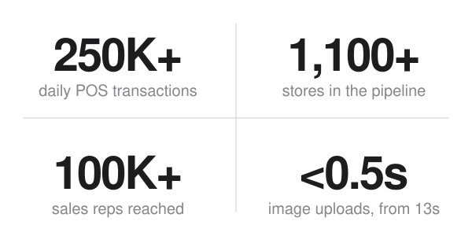

<picture>
  <source media="(prefers-color-scheme: dark)" srcset="assets/header-dark.svg" />
  
</picture>

<a href="https://msinghdev.vercel.app">Portfolio</a> &nbsp;·&nbsp;
<a href="https://linkedin.com/in/manpreet-swe">LinkedIn</a> &nbsp;·&nbsp;
<a href="mailto:manpreet.swe@outlook.com">Email</a> &nbsp;·&nbsp;
<a href="https://www.leetcode.com/manpreetsingh2003">LeetCode</a>

  

<a href="#about">About</a> &nbsp;·&nbsp;
<a href="#results">Results</a> &nbsp;·&nbsp;
<a href="#experience">Experience</a> &nbsp;·&nbsp;
<a href="#projects">Projects</a> &nbsp;·&nbsp;
<a href="#skills">Skills</a> &nbsp;·&nbsp;
<a href="#contact">Contact</a>

 

<picture>
  <source media="(prefers-color-scheme: dark)" srcset="assets/about-dark.svg" />
  
</picture>

Master of Applied Computing candidate at Wilfrid Laurier University, graduating April 2027 with a GPA of 11.34 / 12.

1.5+ years of co-op and internship work across Java and Node.js backends, React, Vue and Svelte front ends, and cloud data pipelines.

AWS Certified Cloud Practitioner.

 

<picture>
  <source media="(prefers-color-scheme: dark)" srcset="assets/results-dark.svg" />
  
</picture>
<picture>
  <source media="(prefers-color-scheme: dark)" srcset="assets/impact-dark.svg" />
  
</picture>

 

<picture>
  <source media="(prefers-color-scheme: dark)" srcset="assets/experience-dark.svg" />
  
</picture>

### Home Hardware
**IT eCommerce Co-op, Full Stack** 
May – Dec 2026 · St. Jacobs, ON · Current

- Shipped 10+ user stories in 1.5 months for a new Pro Dashboard, with reusable Vue.js and Svelte components for data tables and filtering
- Built PySpark ETL pipelines on Microsoft Fabric (Azure) that ingest 250K+ daily POS transactions from 1,100+ stores
- Designed a cross-cloud sync from a Fabric Delta Table to Cloud SQL, incremental by timestamp, through a serverless GCP Cloud Function
- Documented the legacy Reassignment Shipments codebase for future work and production troubleshooting

### Wilfrid Laurier University
**Instructional Assistant, System Programming** 
Jan – Apr 2026 · Waterloo, ON

- Mentored 50+ students in Shell scripting and C, reviewing labs for code quality, memory management and readability

### CoreAI Technologies
**Full-Stack Software Developer** 
May – Oct 2025 · Remote

- Built and component-tested a health analytics dashboard with Next.js, React and TanStack Query
- Created a categorization system for 400+ biomarkers that simplified backend retrieval and frontend navigation

### SalesCode.ai
**Software Engineer Intern** 
Jun – Dec 2024 · Gurugram, India

- Built Spring Boot REST APIs on auto-scaling AWS EC2 and S3 serving geo-targeted banners to 100K+ sales reps, with a 15% lift in click-through rate
- Cut the Flutter client's memory use by over 30% (89MB to 62MB) with widget refactoring and lazy loading

 

<picture>
  <source media="(prefers-color-scheme: dark)" srcset="assets/projects-dark.svg" />
  
</picture>

### [PulseWatch](https://github.com/Manpreet-Singh-Kamboj/PulseWatch)
Uptime monitoring with AI incident summaries. 2nd runner-up at Startup Build Hackathon 2026, backend built in 48 hours.

- Cron-scheduled website, API and SSL checks that classify targets as UP, DOWN or DEGRADED and track each incident from outage to recovery
- OpenAI incident summaries and a streaming dashboard chat assistant, with live check events pushed over Server-Sent Events
- JWT cookie sessions, role-based access, email OTP and Google Sign-In, with alerts by email, Twilio SMS, Slack and Discord

### [Qure](https://github.com/Manpreet-Singh-Kamboj/Qure)
Real-time queue and token management for clinics, with a React Native app and a Node.js backend.

- Socket.IO rooms push live queue updates to patients and staff, behind JWT authentication and role-based authorization
- Atomic PostgreSQL transactions keep token assignment consistent
- BullMQ and Redis handle background uploads, cutting image upload latency from about 13s to under 500ms

### [Skin Lesion Classification](https://github.com/Manpreet-Singh-Kamboj)
Multi-task EfficientNet-B4 model for skin lesion diagnosis and melanoma detection on the imbalanced HAM10000 dataset.

- Focal loss and weighted sampling reached 0.753 melanoma recall and 0.928 AUC-ROC
- Deep-ensemble uncertainty estimates and Grad-CAM++ explanations, served through a Flask REST API to a React (Vite) frontend

 

<picture>
  <source media="(prefers-color-scheme: dark)" srcset="assets/skills-dark.svg" />
  
</picture>

LANGUAGES 

WEB AND APIS 

CLOUD AND DATA 

TOOLS 

 

<picture>
  <source media="(prefers-color-scheme: dark)" srcset="assets/contact-dark.svg" />
  
</picture>

<a href="mailto:manpreet.swe@outlook.com">manpreet.swe@outlook.com</a>

<a href="https://linkedin.com/in/manpreet-swe">LinkedIn</a> &nbsp;·&nbsp;
<a href="https://msinghdev.vercel.app">Portfolio</a> &nbsp;·&nbsp;
<a href="https://github.com/Manpreet-Singh-Kamboj">GitHub</a> &nbsp;·&nbsp;
<a href="https://www.leetcode.com/manpreetsingh2003">LeetCode</a>

